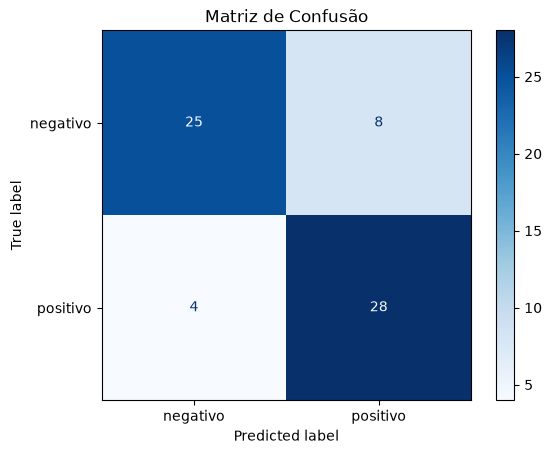

# RELATORIO — Análise de Sentimento com PLN

**Nome: Matheus Santos Leffa** 
**Repositório: https://github.com/Matheus-Leffa/Classificador_sentimentos_NLP** 
**Data: 17/11/2026** 

## Tabela-resumo (preencha com os seus resultados)

| Config | Stopwords | Vetorizador | Vocabulário | Acurácia CV (média ± desvio) | F1 CV (média ± desvio) |
|---|---|---|-------------|------------------------------|------------------------|
| A | mantidas | BoW | 420         | 0.8154                       | 0.856                  |
| B | mantidas | TF-IDF | 420         | 0.8615                       | 0.845                  |
| C | removidas | BoW | 406         | 0.8308                       | 0.840                  |
| D | removidas | TF-IDF | 406         | 0.8308                       | 0.851                  |

**Configuração escolhida:** A **Acurácia no teste:** 0.8154 **F1 no teste:** 0.856

---

## 1. Pré-processamento
*Quais decisões você tomou (minúsculas, pontuação, números, stopwords)? Qual o tamanho do vocabulário com e sem remoção de stopwords? O que você fez com a palavra "não" e por quê?*

Criei uma função chamada prep() que transforma todas as letras em minúsculas,
Identifica e extrai apenas palavras compostas por letras de a a z e caracteres acentuados especificados na expressão regular.
Remove pontuações e números.
Permite remover as palavras presentes em STOP(stopwords).
Com as stopwords temos 420 palavras. Sem stopword temos 402 (18 palavras foram removidas).
A palavra "não" foi mantida pois ela pode mudar completamente o sentido de uma frase.

## 2. BoW vs. TF-IDF
*Compare as quatro configurações levando em conta o desvio padrão. As diferenças são relevantes? Qual você escolheu e com base em quê? Explique a diferença conceitual entre as duas representações.*

As 4 configurações possuem um desvio padrão quase equivalente, o que indica que não há uma config expressivamente superior as demais neste aspecto. 
A ConfigA apresentou o melhor resultado, com F1 médio de 0,8563 e desvio padrão de 0,0926.
A BoW considera a frequência com que as palavras aparecem em um texto, não importando a sua posição nele.
Já a TD-IDF acrescenta pesos às palavras de acordo com a sua frequência e raridade no conjunto inteiro de dados.

## 3. Avaliação no teste
*Mostre a matriz de confusão e interprete precisão, recall e F1 de cada classe. Para uma loja, qual erro é mais grave: classificar uma reclamação como elogio ou o contrário? Por que a acurácia é menos enganosa aqui do que no exemplo de fraude da Aula 8?*

Classe negativa
Precisão: 86,2% - Recall: 75,8%

F1-score: aproximadamente 80,6%
Representa um equilíbrio razoável entre precisão e recall, mas mostra que ainda há dificuldade em identificar todos os comentários negativos.

Classe positiva
Precisão: 77,8% - Recall: 87,5%

F1-score: aproximadamente 82,4%
O desempenho geral para a classe positiva foi ligeiramente superior.

O erro mais grave é classificar uma reclamação como elogio.
Esse erro ocorreu 8 vezes e significa que a loja pode deixar de perceber problemas reais de clientes, não responder à reclamação e prejudicar sua reputação. 

## 4. Validação cruzada vs. divisão única
*Por que a validação cruzada é mais confiável do que um único conjunto de teste para comparar configurações? Por que a escolha não pode ser feita olhando o teste? O que seria vazamento de dados neste trabalho e como você o evitou?*

(sua resposta)

## 5. Análise de erros e palavras influentes
*Escolha 3 textos de `erros.csv` e explique por que o modelo pode ter errado. Observe as 10 palavras mais influentes de cada classe: há alguma que não carrega sentimento por si só (ex.: palavra funcional ou de domínio)? O que isso diz sobre o que o modelo realmente aprendeu?*

(sua resposta)

## 6. Casos difíceis e limitações
*Com base em `casos_dificeis_predicoes.csv`, como o modelo se saiu em negação, ironia e frases mistas? Explique por que BoW/TF-IDF têm essa limitação, proponha duas melhorias (cite técnicas vistas na Aula 11) e discuta duas limitações do dataset e um risco de usar este modelo em produção.*

(sua resposta)

---

## Declaração de uso de IA

Marque uma opção e complete:

- [ ] Não usei IA generativa em nenhuma parte deste trabalho.
- [ ] Usei IA generativa **somente** para: ______________ (não é permitido gerar código ou relatório).
